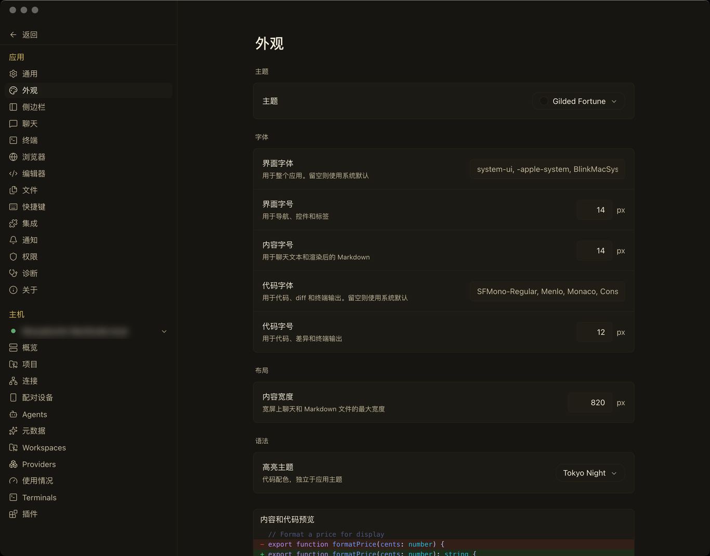
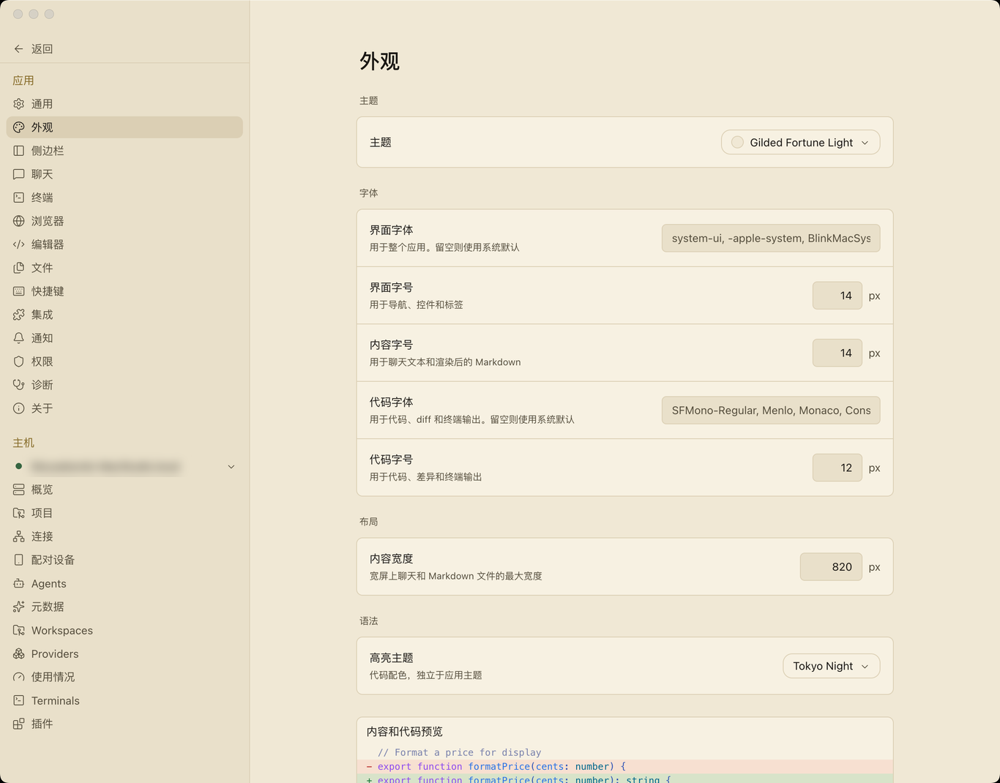
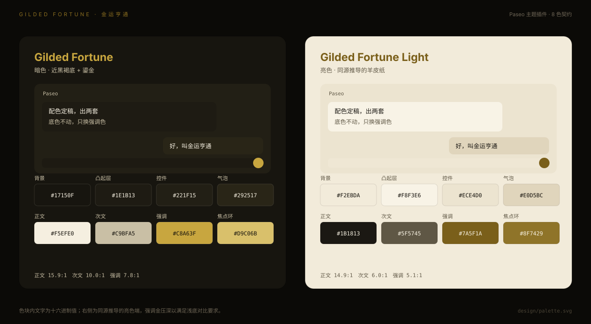

# Paseo Gilded Fortune themes

English | [中文](README.zh.md)

Two themes for [Paseo](https://github.com/getpaseo/paseo): **Gilded Fortune** (dark) and **Gilded Fortune Light** (parchment). Near-black warm brown surfaces, a muted gilded accent, cream body text — both ends built from one palette.

| Dark | Light |
|---|---|
|  |  |



## Install

Requires Paseo 0.8 or newer. Pick one:

### npm

```bash
paseo plugin add npm:@mousebomb/paseo-gilded-fortune
```

### Git

```bash
paseo plugin add github:mousebomb/paseo-gilded-fortune
```

### From source

```bash
git clone https://github.com/mousebomb/paseo-gilded-fortune.git
cd paseo-gilded-fortune
npm install
npm run typecheck
npm test
paseo plugin add .
```

Then turn it on under **Settings → Plugins**, and pick **Gilded Fortune** or **Gilded Fortune Light** under **Settings → Appearance → Theme**.

Reload after editing:

```bash
paseo plugin reload gilded-fortune
```

## Design notes

- The plugin contributes only the eight colors Paseo exposes to themes; everything else is derived by the app, so updates never overwrite it.
- The dark accent is `#c8a63f` (55% saturation) rather than the source page's `#d4af37` (65%) — same hue and lightness, gentler over long sessions.
- The light accent has to sit at `#7a5f1a`; brighter golds drop below the 4.5:1 body-text threshold on parchment.
- `border` also paints the user message bubble, so it is one step deeper than the card surface (`#292517`), giving 13.4:1 against body text.
- The light `ring` is `#8f7429`: Paseo uses that token for both the selected sidebar row and faint text, so a mid tone keeps both usable. See `AGENTS.md`.

Full values and contrast ratios: [`design/palette.svg`](./design/palette.svg), generated by `design/gen_palette_svg.py`.

## License

MIT. The palette is derived from the author's own five-element "metal" (补金) page; no third-party palette license applies.

The icon's 「金」glyph is rendered to a bitmap from [Source Han Serif](https://github.com/adobe-fonts/source-han-serif) CN Heavy (SIL Open Font License 1.1); the font itself is not distributed with the plugin.
